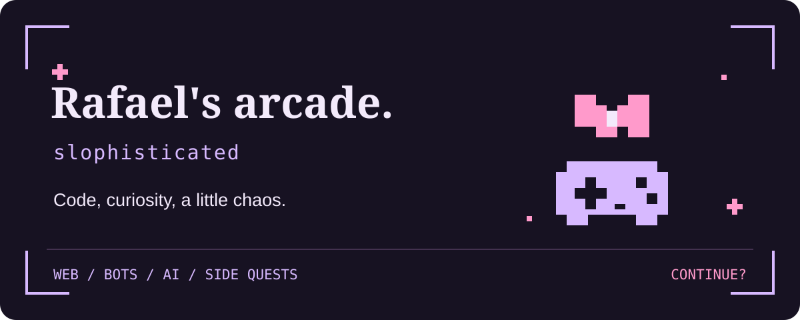

  

# Hey, I'm Rafael.

**Computer Engineering Student · Curious builder · Kuromi enthusiast**

I make things that are useful, a little playful, and occasionally chaotic. Most of my time goes into web apps, Discord bots, and AI experiments — learning by building, one side quest at a time.

[Explore my repos](https://github.com/slophisticated?tab=repositories) · [Find me on Discord](https://discord.com/users/867592202708582401)

---

### On the workbench

**Discord, with a personality.**  
A Kuromi-themed Discord bot with an AI personality, plus a fullstack dashboard for managing bots. Both are works in progress.

**Down the AI rabbit hole.**  
Exploring Hugging Face models and experimenting with local LLMs. Still learning; having fun with it.

### Choose a side quest

- **Web development** — connecting the frontend to what happens behind it.
- **Bots & automation** — making repetitive things do themselves.
- **AI experiments** — trying ideas, breaking things, figuring out why.
- **Cybersecurity** — beginner territory; curious about CTFs.
- **Roblox scripting** — occasional experiments in Roblox Studio.

### Inventory

**Languages**  
`Python` `JavaScript` `C++` `C` `Lua` `Java`

**Tools**  
`Git` `VS Code` `Jupyter Notebook` `Roblox Studio`

<strong>Open the scoreboard</strong>

 

These cards come from an external service and may be temporarily unavailable. Language usage reflects public repositories, not proficiency.

---

### Player two?

Say hi on Discord: **[`aprctprince`](https://discord.com/users/867592202708582401)**  
Portfolio is still in the works.

Small experiments. Useful things. A little chaos.

