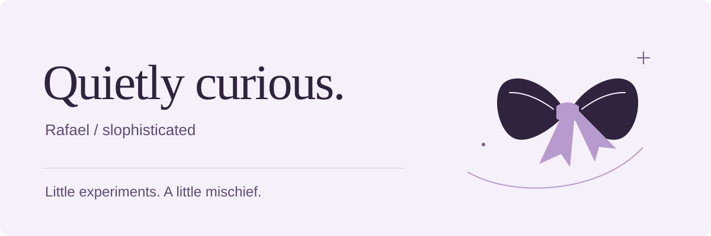

  

  Computer Engineering · web, bots &amp; AI

 

  

 

  

  <a href="https://github.com/slophisticated?tab=repositories">repos</a>
  &nbsp; · &nbsp;
  <a href="https://discord.com/users/867592202708582401">discord</a>

A little more

I'm Rafael, a Computer Engineering student exploring web development, Discord bots, AI, cybersecurity, and Roblox scripting.

Currently experimenting with a Kuromi-themed AI bot, a bot-management dashboard, and local LLMs. Discord: `aprctprince`.

Languages: Python, JavaScript, C++, C, Lua, Java. Tools: Git, VS Code, Jupyter Notebook, Roblox Studio.

